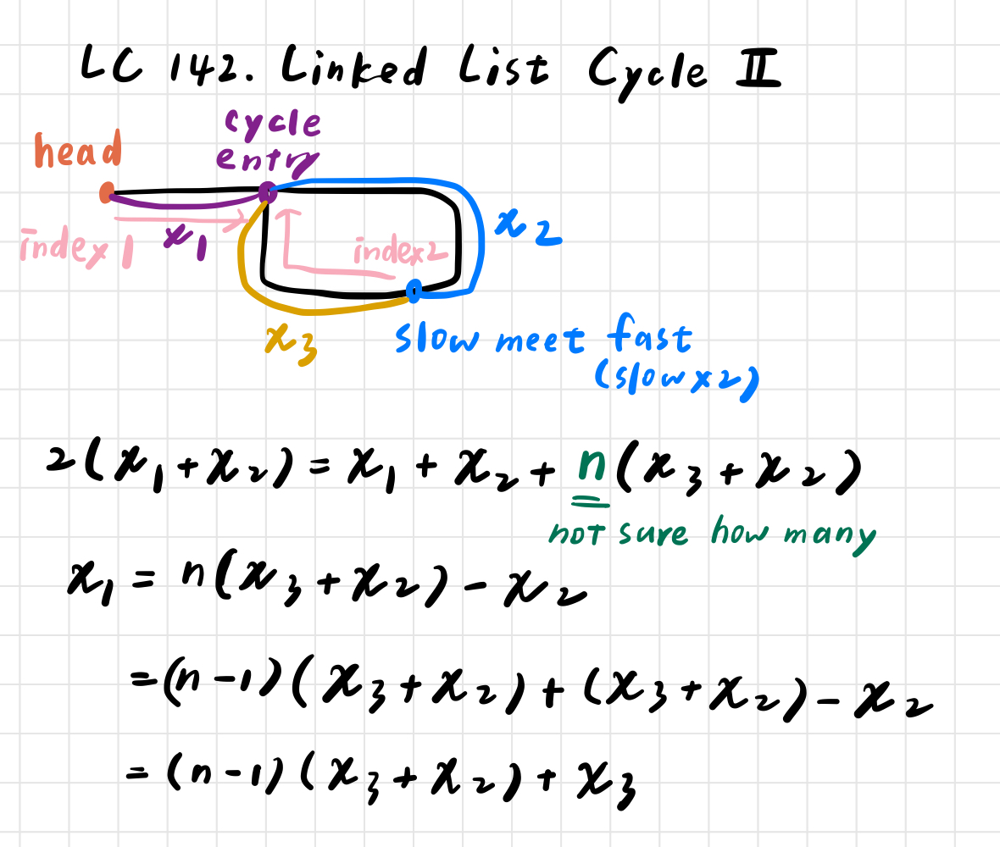

# [0142] 環形鏈結串列 II (Linked List Cycle II)

- **難度**：Medium
- **標籤**：`Hash Table` `Linked List` `Two Pointers`
- **刷題日期**：2026-11-17
- **複習狀態**：🟡 理解推導後完成

---

## 1. 題目理解與邊界條件 (Input / Output / Constraints)
* **題目目標**：給定一個單向鏈結串列的頭節點 `head`，判斷串列中是否存在環（Cycle）。若存在環，回傳**環的入口節點指標（`ListNode*`）**；若不存在環，回傳 `nullptr`。
* **題目規格釐清**：
  - 題目敘述中的 `pos` 僅為測試系統在後台建立環狀指標的示意參數，並不會傳入函式；函式實際要求回傳的是入口節點的記憶體位址（`ListNode*`），而非整數索引。
  - **不可修改原本的鏈結串列結構**（不能靠把走過的節點 `next` 指斷或改值來標記）。
* **輸入限制**：
  - 節點數量範圍為 $[0, 10^4]$（允許空串列輸入 `head == nullptr`）。
  - $-10^5 \le \text{Node.val} \le 10^5$。
  - 進階挑戰：使用 $O(1)$ 額外空間複雜度解決。
* **特殊狀況 (Edge Cases)**：
  - 空串列（`head == nullptr`）或僅有一個無環節點（`head->next == nullptr`）：直接回傳 `nullptr`。
  - 整條串列形成一個大環（尾節點直接連回 `head`，即入口就是 `head` 本身）。
  - 僅有單一節點且自我成環（`head->next == head`）。

---

## 2. 思路演進 (Intuition & Thought Process)

### 🔴 雜湊表紀錄法 (Hash Set) - 直覺解法
* **直覺**：走訪串列時，將每個造訪過的 `ListNode*` 位址存入 `unordered_set`。第一個重複出現的節點位址即為環的入口。
* **瓶頸**：雖然時間複雜度為 $O(N)$，但需要額外 $O(N)$ 空間儲存所有節點位址，不符合進階要求的 $O(1)$ 空間限制。

### 🟢 最佳化解法：快慢雙指標與步數等式推導 (Floyd's Cycle-Finding Algorithm)
* **核心策略（兩階段雙指標）**：
  1. **第一階段（判斷有環並尋找相遇點）**：
     - 令 `fast` 與 `slow` 同時從 `head` 出發，`fast` 每次走 **2 步**，`slow` 每次走 **1 步**。
     - 若 `fast` 走到空指標（`fast == nullptr || fast->next == nullptr`），代表串列無環，直接回傳 `nullptr`。
     - 若有環，因進入環後 `fast` 相對於 `slow` 的速度差為 $2 - 1 = 1$ 步，兩者間距每次縮小 1 格，`slow` 在走完第一圈前必然與 `fast` 在環內某處相遇（`fast == slow`）。
  2. **第二階段（從起點與相遇點同步出發尋找入口）**：
     - 當 `fast == slow` 相遇時，派兩個新指標 `index1`（從起點 `head` 出發）與 `index2`（從相遇點出發），兩者**每次皆只走 1 步**，最終必定會在**環的入口節點**相遇。

* **數學推導**：
    
  - 設 $x$ 為起點到環入口的距離，$y$ 為環入口到相遇點的距離，$z$ 為相遇點沿前進方向回到環入口的距離（環總長為 $y + z$）。
  - 相遇時，`slow` 走過總步數為 $x + y$；`fast` 已在環內繞了 $n$ 圈（$n \ge 1$），走過總步數為 $x + y + n(y + z)$。
  - 因 `fast` 速度為 `slow` 的 2 倍，建立步數等式：
    $$2(x + y) = x + y + n(y + z)$$
  - 化簡並將 $n$ 圈拆出一圈 $(y + z)$：
    $$x = n(y + z) - y = (n - 1)(y + z) + (y + z) - y = (n - 1)(y + z) + z$$
  - **結論**：當 `index1` 從 `head` 走 $x$ 步抵達環入口時，`index2` 從相遇點同步走 $x$ 步，相當於在環內先繞 $(n - 1)$ 圈回到相遇點後再前進 $z$ 步，**兩者必然同時停在環的入口節點**。

---

## 3. 複雜度分析 (Complexity Analysis)
* **時間複雜度**：$O(N)$ — 第一階段 `slow` 進入環後不到一圈即會與 `fast` 相遇，走訪步數小於 $N$；第二階段 `index1` 從起點走到環入口步數為 $x < N$，總操作次數為線性時間 $O(N)$。
* **空間複雜度**：$O(1)$ — 僅使用常數個指標變數（`fast`、`slow`、`index1`、`index2`），完全不需額外資料結構。

---

## 4. 易錯點與盲點總結 (Key Takeaways)
* **外層迴圈條件必須保護 `fast->next`**：第一階段推進指標時需執行 `fast = fast->next->next`，因此 `while` 條件必須寫成 `fast != nullptr && fast->next != nullptr`（利用短路求值先確認 `fast` 非空，再檢查 `fast->next`），避免無環串列在尾端觸發空指標崩潰。
* **切勿在未確認相遇前比較位址**：起始時 `fast` 與 `slow` 都初始化在 `head`，必須先各自移動一步後，再判斷 `if (fast == slow)`，否則一進入迴圈就會誤判為在 `head` 相遇。
* **C++ 空指標語意規範**：一律使用 `nullptr` 取代 `NULL`，因 `NULL` 在 C++ 中本質為整數 `0`，而 `nullptr` 具備嚴格的指標型別安全（`std::nullptr_t`），可避免多載與型別推導歧義。

---
## 5. 程式碼實作 (C++)

```cpp
/**
 * Definition for singly-linked list.
 * struct ListNode {
 *     int val;
 *     ListNode *next;
 *     ListNode(int x) : val(x), next(NULL) {}
 * };
 */
class Solution {
public:
    ListNode *detectCycle(ListNode *head) {
        ListNode* slow = head;
        ListNode* fast = head;
        while(fast != nullptr && fast->next != nullptr){
            slow = slow->next;
            fast = fast->next->next;
            if(slow == fast){
                ListNode* tmp1 = head;
                ListNode* tmp2 = slow;
                while(tmp1!=tmp2){
                    tmp1 = tmp1->next; //從head走到環的起點
                    tmp2 = tmp2->next; //從快慢指標的相遇點走到環的起點
                }
                return tmp1;
            }
        }
        return nullptr;
    }
};
```